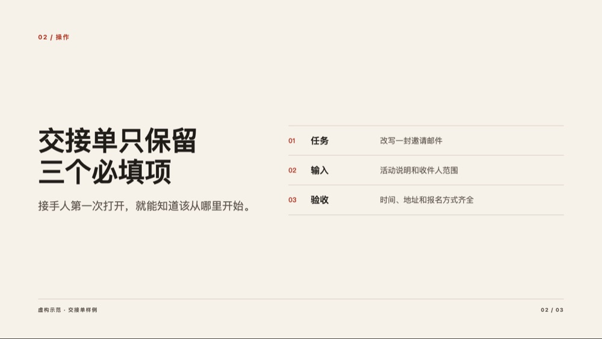

# Amber Deck Skill

一套给 AI 用的演示设计方法。适合从文档做 PPT、把旧稿改得更清楚、还原参考稿，或为现场做可控的网页演示。

核心流程：**先锁受众与主张 → 选一个视觉方向 → 做三张关键页 → 渲染逐页验收**。正式稿的重点是让证据清楚；现场稿才为主持节拍安排动效。

## 3 分钟上手

**无需安装：**把 [SKILL.md](SKILL.md) 和这份仓库地址交给能读文件的 AI，然后用下面的示例。某些环境不能跟读 GitHub 链接，直接下载 ZIP，把解压后的目录交给 AI。

**安装到 Codex 或 Claude Code：**

```bash
git clone https://github.com/hiamberhuang/amber-deck-skill.git
cd amber-deck-skill
python3 scripts/install.py --host codex
# Claude Code 用户改用 --host claude
```

在新对话说：

> 用 amber-deck-skill 把我附的框架做成一份给客户读的可编辑 PPTX。保留原来的关键观点，先做封面、证据页和行动页；原文没证实的数字不要写。交付 PPTX 和逐页预览。

> 用 amber-deck-skill 做一个可离线播放的 16:9 大屏。动效只在揭示顺序和章节切换使用；要能用键盘翻页、黑屏、重播，并有静态备份。

> 用 amber-deck-skill 审稿。先告诉我每页的主张、最强证据和要删的东西，按优先级排序。保留可编辑文字、图表和母版。

Skill 负责方法和验收；PPTX 生成、图片生成或浏览器渲染由你的 AI 环境中相应工具完成。遇到只能导出图片的工具，要事先说明编辑性差异。

## 看效果和选工具



- [示范 Deck](examples/demo.html)：原创、可离线运行；下载后双击打开，按方向键翻页，R 重播、B 黑屏。它使用虚构材料。
- [审美与叙事](references/art-direction.md)：正式提案、产品、舞台、复刻、决策五条路径，含该强调、可放过、要删的内容。
- [120 张配方卡](references/effect-recipes.md)：排版、数据证据、原生动画、网页动效和控场。
- [GitHub 选型表](references/github-index.md)：按任务查 Skill 和工具，含星数、许可与归档状态；星数不是效果评分。
- [审稿清单](references/review.md)和[动效与交付](references/motion-and-output.md)：以实际 PPTX、HTML 或 PDF 的渲染为准。

## 团队怎样复用原件

公开包提供方法、样例与本地素材工具。组织原件由你们已有的受控资产库管理。给 AI 一个有权使用的样稿或单页；若团队有已索引的本地素材库，可按 [本地素材库指南](references/local-vault.md) 搜索项目，复制整套源码或指定文件到新目录。使用者的权限仍决定能读取哪些文件。

## 反馈

提交公开问题时请使用虚构样例，说明交付格式、哪一页出了问题、希望变成什么样；不要附原客户材料或内部截图。代码与原创说明适用 [MIT License](LICENSE)；第三方链接指向各自的许可。
